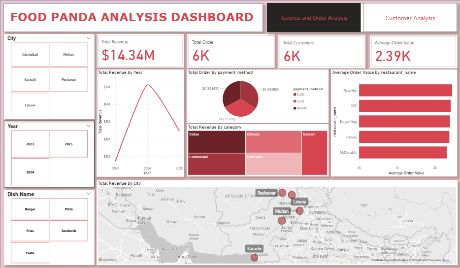

# POWER BI FOODPANDA REVENUE AND ORDER, CUSTOMER DASHBOARD

## Project Overview
The Foodpanda Data Analysis project focuses on analyzing customer, sales, restuarant, and delivery performance data to generate
meaningful business insights. The objectiveis to understand customer purchasing behaviour, identify sales trends, evaluate customer 
satisfaction, and assess customer retention and churn. Using Microsoft Power BI, the data analyzed and presented through interactive
dashboards to help identify business opportunities, improve operational efficiency, and support data-driven decision making.

## Tools Used
-**Microsoft Power BI**: For creating interactive dashboards, visualizing sales trends, analyzing customer behavior, and presenting 
findings.

-**CSV Dataset**: The Data source used for the analysis, containing customer, order, restuarant, and delivery information.

-**Power Query**: For the initial data inspection, reviewing records, and basic data cleaning.

-**DAX(Data Analysis Expression) **: For creating measures, KPIs and business calculations.

-**Data Visualization**: For presenting insights through charts, graphs, cards, and other visuals to present clear insights and enable
interactive data exploration.

## Key Insights
Based on the analysis of your dataset containing 6,000 customer records and 6,000 orders, these are the key insights you can present in your Power BI project.

1. **Sales and Revenue Performance**
Total revenue: 14.34 million.
Average Order Value (AOV): 2,380.65.
Top-performing city: Multan generated the highest revenue, approximately 3.05 million.

**Insight**: Multan is the strongest city by revenue. Foodpanda should investigate the factors behind these results to identify opportunities for growth.

2. **Customer Purchasing Behavior**
Top age group: Teenagers placed the most orders
Gender: Male and female customers placed almost identical numbers of orders.
Top restaurant by orders: Subway, with 1,260 orders.
Top restaurant by revenue: Pizza Hut, with approximately 3.00 million.
Most popular food category: Italian.
Most-used payment method: Cash

**Insight**: Teenagers represent the largest age group by order volume, while Italian food and pasta are the most popular category and dish, respectively. These findings could inform targeted promotions.

3. **Customer Satisfaction**
Average customer rating: 3.00 out of 5.
Most common rating: Three stars, representing 20.72% of ratings.
Approximately 39.48% of customers gave ratings of one or two stars.

**Insight**: Customer satisfaction has room for improvement. Investigating low ratings and their relationship with delivery performance could help identify areas requiring attention.

4. **Customer Retention and Churn**
Active customers: 3,016 (50.27%).
Inactive customers: 2,984 (49.73%).
City with the highest inactive customer rate: Lahore, at 51.85%.
Age group with the highest inactive rate: Seniors, at 51.43%.

**Insight**: Nearly half of the customers are classified as inactive. Lahore and the senior customer segment have comparatively higher inactive rates and may warrant further investigation.

## Dashboard Preview

